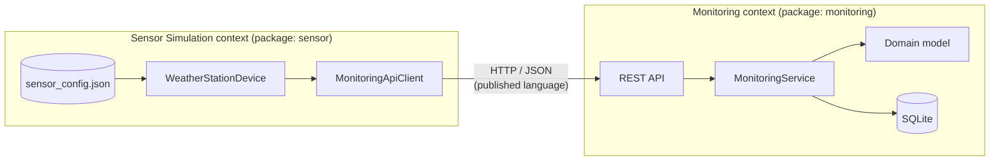
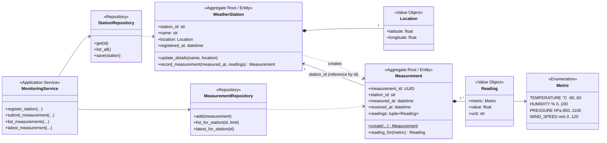
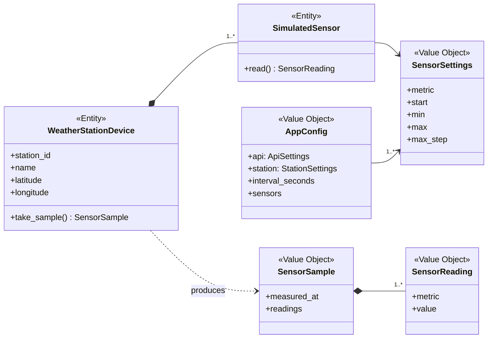
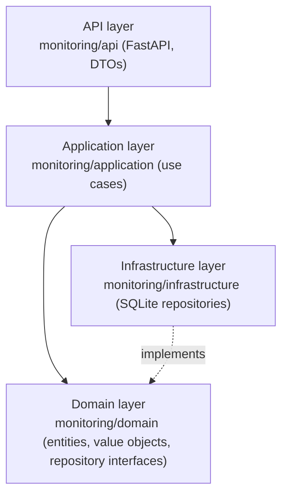
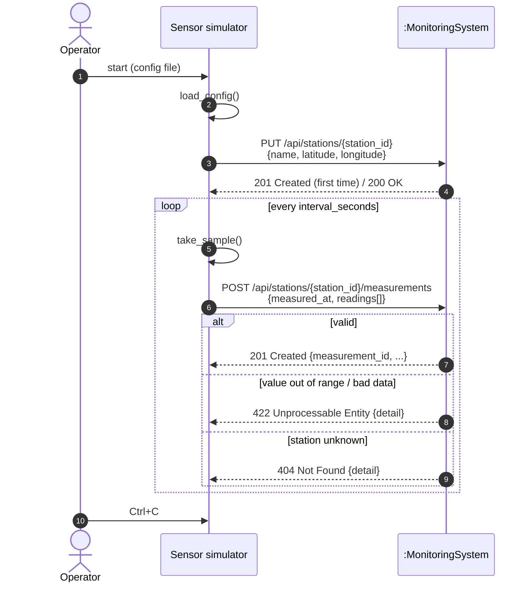
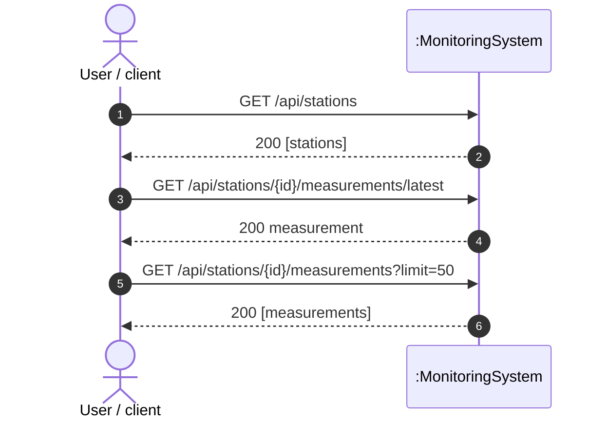
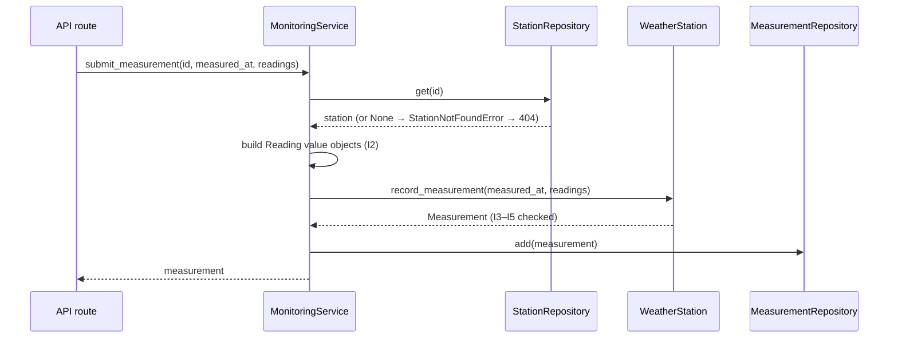
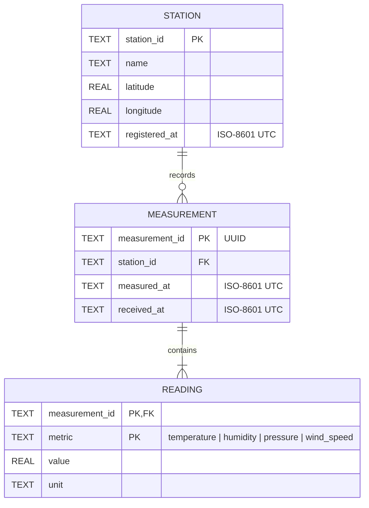

# Design Document – IoT Weather Data Monitoring

| | |
|---|---|
| Version | 1.0 (covers requirement **R1**) |
| Date | 2026-11-05 |
| Approach | Domain-Driven Design (DDD) |

> All diagrams are written in [Mermaid](https://mermaid.js.org/). They render directly on GitHub
> and in VS Code (with the *Markdown Preview Mermaid Support* extension).

---

## 1. Requirement

> **R1:** Simulate a weather station sensor that sends data to a central API.
> Sensor parameters and the API IP address can be changed from a configuration file.

### 1.1 Use cases derived from R1

| ID | Use case | Actor | Description |
|----|----------|-------|-------------|
| UC1 | Configure sensor | Operator | Edit `config/sensor_config.json` (station, sensors, API IP/port, interval). |
| UC2 | Register station | Sensor simulator | On start-up the station tells the API who it is and where it is. |
| UC3 | Submit measurement | Sensor simulator | Every *interval* seconds the station sends its current readings. |
| UC4 | View data | Operator / client | Read stations and their measurements from the API. |

---

## 2. Ubiquitous language

The words below are used *the same way* in conversations, in the code and in the API.

| Term | Meaning |
|------|---------|
| **Weather station** | A device (here simulated) at a fixed location that has several sensors. Identified by `station_id`. |
| **Sensor** | Part of a station that measures one *metric*. |
| **Metric** | The kind of quantity measured: `temperature`, `humidity`, `pressure`, `wind_speed`. Each metric has a fixed **unit** and a **valid range**. |
| **Reading** | One value for one metric, e.g. *temperature = 12.3 °C*. |
| **Measurement** | All readings a station took at the same moment (`measured_at`). |
| **Registration** | The act of a station making itself known to the central API. |
| **Location** | Latitude / longitude of a station. |

---

## 3. Bounded contexts

The system is split into two bounded contexts. Each has its own model and they only share the
**published API contract** (JSON over HTTP).



| Context | Responsibility | Core domain? |
|---------|----------------|--------------|
| **Monitoring** | Accept, validate and store weather data; answer queries. | Yes – business rules live here. |
| **Sensor Simulation** | Produce realistic fake data and send it. | Supporting – will later be replaced by real hardware. |

Context-map relationship: **Customer / Supplier** with a **Published Language** (the JSON API).
The sensor is the customer of the Monitoring API.

---

## 4. Domain model

### 4.1 Monitoring context (core)



#### Why two aggregates?

A station can produce millions of measurements. Putting them all inside the `WeatherStation`
aggregate would make it huge and slow to load. So `Measurement` is its own aggregate and
**references the station by id** (a standard DDD rule: *reference other aggregates by identity*).

#### Invariants (business rules) enforced by the domain

| # | Rule | Where |
|---|------|-------|
| I1 | Latitude ∈ [-90, 90], longitude ∈ [-180, 180] | `Location` |
| I2 | A reading's value must lie inside the metric's valid range | `Reading` |
| I3 | A measurement has at least one reading | `Measurement.create` |
| I4 | A metric appears at most once per measurement | `Measurement.create` |
| I5 | `measured_at` may not be in the future (60 s clock tolerance) | `Measurement.create` |
| I6 | Only a **registered** station can submit measurements | `MonitoringService` + `WeatherStation.record_measurement` |
| I7 | Station id and name may not be empty | `WeatherStation` |

### 4.2 Sensor Simulation context (supporting)



Each `SimulatedSensor` performs a **bounded random walk**: the next value is the previous value
± a random step (≤ `max_step`), clamped to `[min, max]`. This gives realistic, slowly-changing data.

### 4.3 Layered architecture (Monitoring context)



The **domain layer has no dependencies** on FastAPI, SQLite or HTTP. It can be tested alone
(`tests/test_domain.py`).

---

## 5. System sequence diagrams

### 5.1 SSD – UC2 + UC3: sensor start-up and sending data

The system is treated as a black box (the Monitoring API).



If the API is not reachable during registration, the simulator retries every
`interval_seconds`. If sending a sample fails, the error is logged and the loop continues.

### 5.2 SSD – UC4: viewing data



### 5.3 Internal sequence – how "submit measurement" flows through the layers



---

## 6. ER diagram (persistence)



Mapping from domain to tables:

| Domain | Table | Note |
|--------|-------|------|
| `WeatherStation` + `Location` | `station` | Value object `Location` is *flattened* into two columns. |
| `Measurement` | `measurement` | |
| `Reading` (value object) | `reading` | No own id; the composite key `(measurement_id, metric)` also enforces invariant I4. |

Index: `measurement(station_id, measured_at DESC)` for fast "latest" queries.

---

## 7. API documentation

Base URL: `http://<api-host>:<port>` (default `http://127.0.0.1:8000`).
Interactive OpenAPI docs are generated automatically at **`/docs`** (Swagger UI) and **`/redoc`**.

All bodies are JSON. Timestamps are ISO-8601; times without a timezone are treated as UTC.

### 7.1 Endpoints overview

| Method | Path | Description | Success |
|--------|------|-------------|---------|
| GET | `/health` | Liveness check | 200 |
| PUT | `/api/stations/{station_id}` | Register or update a station (idempotent) | 201 / 200 |
| GET | `/api/stations` | List all stations | 200 |
| GET | `/api/stations/{station_id}` | Get one station | 200 |
| POST | `/api/stations/{station_id}/measurements` | Submit a measurement | 201 |
| GET | `/api/stations/{station_id}/measurements?limit=100` | List measurements, newest first (`limit` 1–1000) | 200 |
| GET | `/api/stations/{station_id}/measurements/latest` | Latest measurement | 200 |

### 7.2 Register a station

`PUT /api/stations/ws-001`

```json
{
  "name": "Roof station, building A",
  "latitude": 55.6761,
  "longitude": 12.5683
}
```

Response `201 Created` (new) or `200 OK` (updated):

```json
{
  "station_id": "ws-001",
  "name": "Roof station, building A",
  "latitude": 55.6761,
  "longitude": 12.5683,
  "registered_at": "2026-11-05T13:47:12.940000Z"
}
```

*Why PUT and not POST?* The client chooses the id and calling it twice has the same effect,
so the sensor can safely re-register every time it starts.

### 7.3 Submit a measurement

`POST /api/stations/ws-001/measurements`

```json
{
  "measured_at": "2026-11-05T13:47:13.369145+00:00",
  "readings": [
    { "metric": "temperature", "value": 12.02 },
    { "metric": "humidity",    "value": 69.45 },
    { "metric": "pressure",    "value": 1012.63 },
    { "metric": "wind_speed",  "value": 4.88 }
  ]
}
```

Response `201 Created`:

```json
{
  "measurement_id": "294a3f8b-4fe8-41e5-8289-a938b6f787e2",
  "station_id": "ws-001",
  "measured_at": "2026-11-05T13:47:13.369145Z",
  "received_at": "2026-11-05T13:47:13.371555Z",
  "readings": [
    { "metric": "humidity",    "value": 69.45,   "unit": "%" },
    { "metric": "pressure",    "value": 1012.63, "unit": "hPa" },
    { "metric": "temperature", "value": 12.02,   "unit": "°C" },
    { "metric": "wind_speed",  "value": 4.88,    "unit": "m/s" }
  ]
}
```

The sensor sends no units – the **server owns the unit** for each metric (part of the domain).

### 7.4 Errors

| Status | When | Body example |
|--------|------|--------------|
| 404 | Station not registered | `{"detail": "station 'ws-999' is not registered"}` |
| 404 | No measurements yet (`/latest`) | `{"detail": "no measurements yet"}` |
| 422 | Domain rule broken (I1–I5, I7) | `{"detail": "humidity=150.0 is outside the valid range [0.0, 100.0]"}` |
| 422 | Malformed JSON / unknown metric / missing field | FastAPI validation error list |

---

## 8. Configuration file

`config/sensor_config.json`

| Key | Meaning |
|-----|---------|
| `api.host` | **IP address** (or host name) of the central API |
| `api.port` | Port of the central API |
| `api.timeout_seconds` | HTTP timeout |
| `station.*` | Identity and location of the simulated station |
| `interval_seconds` | Seconds between two measurements |
| `sensors[]` | One entry per sensor: `metric`, `start`, `min`, `max`, `max_step` |

Remove an entry from `sensors` to simulate a station without that sensor. The simulator validates
the file at start-up (e.g. `min ≤ start ≤ max`) and stops with a clear message if it is wrong.

---

## 9. Ideas for the next iterations

The design is prepared for gradual extension:

| Possible requirement | Where it fits |
|----------------------|---------------|
| Several stations at once | Start the simulator several times with different config files – already works. |
| New metric (e.g. rain, UV) | Add to `Metric` enum + `_METRIC_INFO`; add to the config. |
| Alarms / thresholds (e.g. "temperature > 30 °C") | New `Alert` aggregate + domain event `MeasurementRecorded`. |
| Authentication of stations | API key per station stored on `WeatherStation`. |
| Statistics (min/max/avg per day) | New query use case / read model. |
| MQTT instead of HTTP | New adapter in the sensor context; the domain stays the same. |
| Dashboard | Front-end that uses the GET endpoints. |
